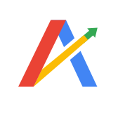
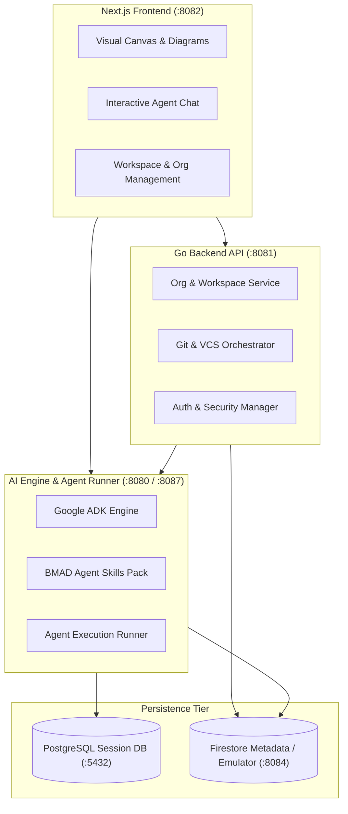

<div align="center">
  <a href="https://github.com/GoogleCloudPlatform/apf">
    
  </a>
</div>

# Agentic Product Foundry

> The Enterprise Agentic Operating System that bridges the gap from product ideation to production software.

[](https://github.com/GoogleCloudPlatform/apf)
[](https://github.com/GoogleCloudPlatform/apf/releases)
[](LICENSE)

Maintained by the **Agentic Product Foundry Team** (Sumeet Singh & Eric Maxwell).  
Repository: [https://github.com/GoogleCloudPlatform/apf](https://github.com/GoogleCloudPlatform/apf)

---

## Table of Contents
- [Why Agentic Product Foundry?](#why-agentic-product-foundry)
- [How It Helps You](#how-it-helps-you)
- [Architecture Overview](#architecture-overview)
- [Prerequisites](#prerequisites)
- [Quickstart: Run in 5 Minutes](#quickstart-run-in-5-minutes)
- [Documentation & Deep Dives](#documentation--deep-dives)
- [Getting Help & Support](#getting-help--support)
- [Contributing](#contributing)
- [License & Terms](#license--terms)

---

## Why Agentic Product Foundry?

With **Agentic Product Foundry**, you can accelerate your team's software delivery lifecycle from initial product concepts to scaffolded, production-ready repositories in minutes instead of weeks.

While modern Internal Developer Platforms (IDPs) automate infrastructure provisioning and deployment, upstream product design—PRD authoring, UX wireframing, technical architecture design, and requirement validation—remains fragmented across documents, wikis, and developer-only terminals.

Agentic Product Foundry breaks down these silos by providing a **centralized visual canvas and collaborative workspace** where Product Managers, UX Designers, Architects, and Developers work alongside specialized AI agents (powered by the BMAD framework and Google's Agent Development Kit). All generated artifacts (PRDs, architecture specs, wireframes, and code) commit directly to your Git repository, preserving a continuous, reviewable, and auditable context chain.

---

## How It Helps You

- **Collaborate across roles visually**: Engage with purpose-built agents (`bmad-pm`, `bmad-ux`, `bmad-architect`, `bmad-developer`) in a shared web GUI featuring interactive canvases, visual modeling, and sidebar chat—no terminal required.
- **Maintain a single source of truth in Git**: Automatically store and version every artifact (requirements, architecture diagrams, user stories, and test plans) directly inside your `.git` tree.
- **Prevent design and code drift**: Leverage historical context calibration and automated gating before code is scaffolded or merged, reducing post-scaffold failures and review friction.
- **Integrate with Enterprise Golden Paths**: Plug smoothly into your internal catalog, CI/CD pipelines, and cloud developer platforms.

---

## Architecture Overview

Agentic Product Foundry coordinates agent orchestration, API management, and real-time visual canvases:



---

## Prerequisites

Before installing Agentic Product Foundry, ensure your local host machine has:

- **Git** (v2.30 or higher)
- **Docker & Docker Compose** (for running local database containers)
- **Google Cloud SDK (`gcloud`)** (for Google Cloud authentication and services)
- **Mise CLI** (for sandboxed toolchain management):
  ```bash
  curl https://mise.run | sh
  ```
- A **Google Gemini API Key** (required for AI features)

---

## Quickstart: Run in 5 Minutes

Follow these steps to clone the repository and launch the full application stack locally:

### 1. Clone the repository
```bash
git clone https://github.com/GoogleCloudPlatform/apf.git
cd apf
```

### 2. Trust the Mise configuration
```bash
mise trust
```

### 3. Run automated environment setup
```bash
mise run env-setup
```
> This downloads all sandboxed runtimes (Go 1.26+, Python 3.13, Node 20, Java 21), prompts you for your `GEMINI_API_KEY`, and generates local configuration files.

### 4. Start all services
```bash
mise run local
```

### 5. Access the application
Open your browser at **[http://localhost:8082](http://localhost:8082)** and sign in with the simulated administrator account:
- **Username:** `super-admin`
- **Password:** `super-admin`

*To stop application processes cleanly, press `Ctrl+C`. To kill lingering background daemons and free ports, run `mise run clean`.*

---

## Documentation & Deep Dives

For in-depth guides and architectural references, explore the dedicated documentation:

| Document | Purpose |
| :--- | :--- |
| **[CONTRIBUTING.md](CONTRIBUTING.md)** | Developer onboarding, local emulator configuration, Cloud SQL proxy, task orchestration, and troubleshooting. |
| **[docs/spec/planning-artifacts/prd.md](docs/spec/planning-artifacts/prd.md)** | Product Requirements Document (PRD) detailing feature specifications, KPIs, and user journeys. |
| **[docs/spec/planning-artifacts/architecture.md](docs/spec/planning-artifacts/architecture.md)** | Technical Architecture Document covering system design, invariants, and security posture. |
| **[docs/database_schema.md](docs/database_schema.md)** | Database schemas, Firestore collections, and data integrity models. |
| **[docs/provisioning.md](docs/provisioning.md)** | Multi-tenant enterprise organization provisioning and administration. |
| **[docs/versioning-strategy.md](docs/versioning-strategy.md)** | Release management, tagging rules, and semantic versioning strategy. |

---

## Getting Help & Support

- **Issue Tracker:** If you encounter a bug or have a feature request, please search existing issues or open a new one in our [GitHub Issues tracker](https://github.com/GoogleCloudPlatform/apf/issues).
- **Security Inquiries:** For sensitive security concerns or vulnerability disclosures, please reach out privately to the maintainers rather than opening a public issue.

---

## Contributing

We welcome contributions from the community!

To get started:
1. Review our [Code of Conduct](CODE_OF_CONDUCT.md).
2. Check the [Contributing Guide](CONTRIBUTING.md) for our coding standards, branch conventions, and step-by-step setup instructions.
3. Submit a Pull Request following the project's PR template.

---

## Disclaimers

This is not an officially supported Google product. This project is not eligible for the [Google Open Source Software Vulnerability Rewards Program](https://bughunters.google.com/open-source-security).

---

## License & Terms

You are free to copy, modify, and distribute **Agentic Product Foundry** with attribution under the terms of the **Apache License 2.0**. See the [LICENSE](LICENSE) file for details.

