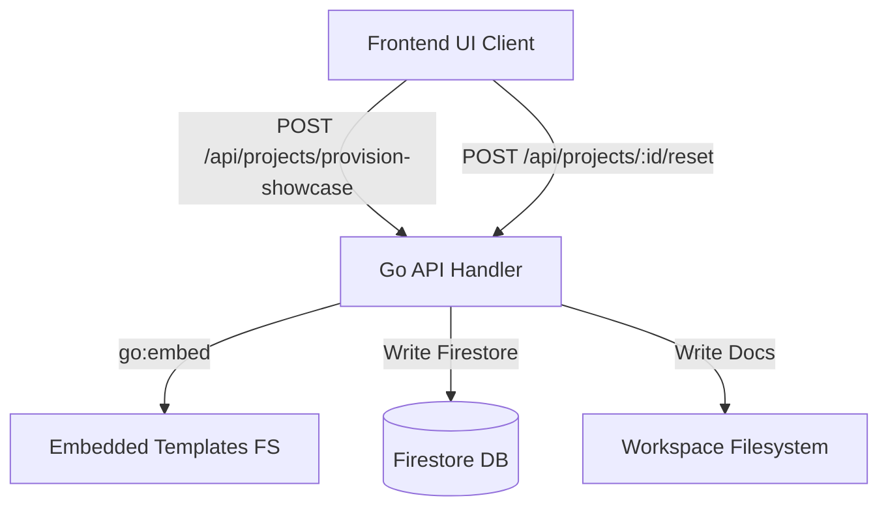

# Architecture Specification
## Project: Foundry Showcase (On-Demand Provisioning)

**Branding**: Foundry Showcase  
**Status**: Final  
**Version**: 1.0  
**Authors**: System Architecture  

---

## 1. System Overview
The Showcase Provisioning and Reset system is integrated into the Go API tier and the Next.js/Next.js React frontend. It uses Go's `embed` package to package the template database entries and workspace specs directly within the compiled Go binary. This allows for rapid, serverless execution without external disk read dependencies.



---

## 2. Core Architectural Components

### 2.1 Embedded Asset Registry
The seeder packages templates inside the binary using:
```go
//go:embed seeding/templates/showcase/*
var showcaseTemplates embed.FS
```
This contains:
- `project.json` - Core project model with pre-completed governance gates.
- `artifacts.json` - Metadata records mapping workspace markdown files.
- `messages.json` - High-fidelity chat history demonstrating agent workflows.
- `workspace/` - Folder containing the markdown spec files.

### 2.2 Seeding Engine (`seedShowcase`)
The seeding engine performs a transactional, multi-step hydrate sequence:
1. **Idempotent Lock**: Resolves or generates a deterministic `projectID` (`showcase-{orgID}-{userID}`). It checks if the project already exists; if so, it returns it immediately (idempotent).
2. **Database Hydration**: 
   - Reads and unmarshals `project.json`, writing to the `projects` collection.
   - Reads `sessions.json` and creates active design sessions.
   - Generates a `project_global_{projectID}` session to capture general workspace chats.
   - Reads `messages.json` and maps message timestamps dynamically using offsets.
   - Reads `artifacts.json` and registers each document in the `artifacts` collection.
3. **Filesystem Extraction**: 
   - Reads all files in the embedded `workspace/` folder.
   - Writes them to the project's local directory path under `docs/spec/` on the mounted workspace filesystem.
4. **Defer-Catch Guard**: If any step fails, a defer block catches the error, deletes all written Firestore records, and removes the local workspace directory completely, ensuring no partial states remain.

### 2.3 Reset Engine (`ResetShowcase`)
The reset engine handles the restoration workflow:
1. **Security Guard**: Verifies that the target `projectId` has the prefix `showcase-` and contains no path traversal elements (`..`, `/`, `\`).
2. **Purge**: Deletes all Firestore sessions, messages, and artifacts matching the project ID, and deletes the project document itself.
3. **Wipe**: Deletes the local workspace filesystem directory (`rm -rf`).
4. **Hydrate**: Invokes `seedShowcase` with the exact same project ID, restoring it to the clean default state.
