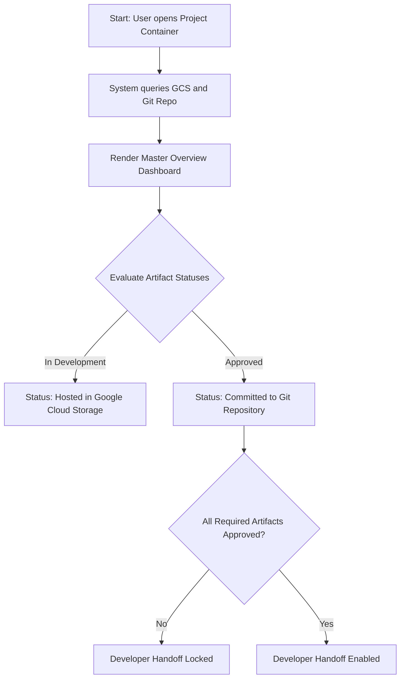
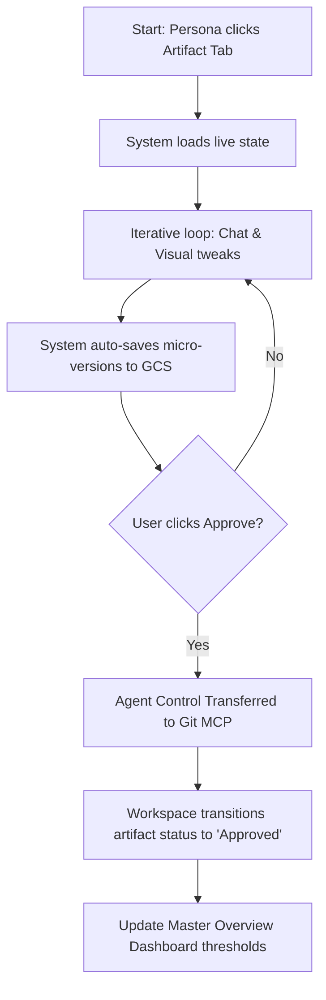

# UX Design Specification agentic-foundry

**Author:** APF Ninja
**Date:** 2026-03-19

---

<!-- UX design content will be appended sequentially through collaborative workflow steps -->

## Executive Summary

### Project Vision
The Agentic Product Foundry (APF) is an Enterprise Enablement Platform that democratizes AI-assisted software delivery. By wrapping open-source agent frameworks (like BMAD) in a centralized, web-based GUI, APF breaks AI orchestration out of the developer's IDE. It provides a shared visual workspace where Product Managers, UX Designers, and Architects can collaborate directly with specialized agents to generate and iterate on repository-centric artifacts in real-time.

### Target Users
*   **Product Managers (PMs):** Need intuitive chat interfaces connected directly to live document outputs (like PRDs) to capture and validate requirements dynamically.
*   **UX Designers:** Require visual, canvas-based node interfaces to map triggers and scenarios, syncing directly with design systems (Figma).
*   **Architects / Tech Leads:** Need structured visualizations of API schemas and topography, tracking validations and ensuring architectural compliance.

### Key Design Challenges
*   **The "IDE Sill":** Translating complex, terminal-based agent commands into an intuitive, accessible web dashboard for non-technical personas.
*   **High-Density Live State:** Displaying real-time collaboration streams, agent activity broadcasts, and asynchronous document status across multiple active users without creating visual clutter or exceeding latency budgets (< 100ms sync latency).
*   **Contextual Dual-Pane Layouts:** Balancing the split-screen paradigm (Agent Chat on one side, Live Artifact/Canvas on the other) to ensure focus is maintained on the primary workspace.

### Design Opportunities
*   **Visual Pipeline Tracking:** The "Idea-to-Production" pipeline bar provides a highly satisfying, gamified sense of progression for teams tracking artifact maturity.
*   **Agent Persona Branding:** Visually distinguishing the specialized agents (`bmad-pm`, `bmad-ux-designer`) with unique avatars and colors (as seen in the mocks) makes the AI feel like a collaborative team member rather than a sterile tool.
*   **Node-Based Canvas Flexibility:** Using a sleek, dark-mode infinite canvas for architectural and flow mapping establishes a "premium," modern feel that justifies the platform's enterprise value.
*   **Accessibility First:** Built with semantic tokens for full WCAG compliance and seamless light/dark theme toggling.

## Core User Experience

### Defining Experience
The core of the APF experience is the **Synchronous Dual-Pane Handoff**. Users interact conversationally with specialized agents (e.g., `bmad-ux-designer`) mapping inputs to real-time artifact generation or node-canvas visual updates. 

The defining climax of this experience is the **Developer Handoff**. Using the same GUI, a developer navigates to a dedicated tab to verify that all upstream planning artifacts have been assembled in the repository. Upon receiving a "green light" status, the developer seamlessly transitions from the web workspace to their local IDE (like AntiGravity), instantly cloning the fully-hydrated repository to begin the BMAD implementation phase.

### Platform Strategy
The application will be developed exclusively as an uncompromising **Web-based Desktop GUI** optimized for deep-focus keyboard and mouse interactions. Due to the complexity of the canvas logic and multi-persona workflows, there is **no requirement for a mobile application**. Focus will be entirely on high-density information layouts for desktop monitors.

### Effortless Interactions
Transmitting context must be invisible. The most delightful and effortless interaction occurs when a user concludes a session—whether it's PRD drafting or UI node mapping—and the platform autonomously commits those robust specifications to the branch. This eliminates the dreaded copy-paste friction of fragmented AI tools. 

Because the system leverages Git repositories out of the box, these agent commits natively trigger **Pull Requests**, creating an effortless human-in-the-loop review mechanism where peers can approve artifacts using familiar developer workflows.

### Critical Success Moments
The ultimate "Aha!" moment happens when a developer clicks into their designated workspace tab and sees the pipeline tracker fully resolved and glowing green. Providing developers immediate, organized access to an actionable, fully-hydrated repository without manual ingestion steps establishes APF as fundamentally better than legacy developer platforms. 

Another critical success moment is the **PR Approval event**, where a team leader reviews the agent-compiled artifact via a standard pull request UI, building extreme trust in the automated outputs.

### Experience Principles
*   **Context is Code:** If it isn't committed as an artifact in the repository, it doesn't exist. All agent interactions must drive toward repo commits and subsequent Pull Request reviews.
*   **Radical Transparency:** The "Collaboration Live Stream" and pipeline trackers must distinctly broadcast agent activities so any persona never feels out of the loop.
*   **One Workspace, Multiple Personas:** The GUI shifts lenses dynamically (PM view, UX view, Developer view) while rendering identical underlying data context.
*   **Design for Desktop Deep Work:** Always optimize layouts for large screens; do not compromise advanced node functionality for mobile responsiveness.

## Desired Emotional Response

### Primary Emotional Goals
Users should feel **Empowered, Trusting, and Unburdened**. The platform should feel like an extension of their own cognitive capacity. When a PM or UX Designer uses APF, they shouldn't feel like they are wrestling with an obtuse enterprise orchestration tool; they should feel like they have a direct, magical conduit to ship code. 

### Emotional Journey Mapping
*   **Discovery (First Use):** *Intrigue and Premium Comfort*. The sleek, dark-mode GUI implies power and capability, making the user eager to explore the canvas.
*   **Core Interaction (Agent Chat & Canvas):** *Flow and Focus*. The dual-pane layout allows users to enter a deep flow state, watching their ideas instantly materialize into complex topographies without distraction.
*   **Completion (Handoff & PR):** *Accomplishment and Relief*. Seeing the pipeline tracker glow green and knowing that the PR is autonomously waiting in the repository provides a profound sigh of relief—the busywork is gone.

### Micro-Emotions
*   **Trust over Skepticism:** In AI tools, skepticism runs high. APF counters this by showing the "Collaboration Live Stream," ensuring the user always trusts what the agents are doing behind the scenes.
*   **Confidence over Confusion:** Node layouts can be overwhelming. The UI must ensure the user always feels confident navigating the canvas, never lost in an infinite plane.

### Design Implications
*   **If we want users to feel Trust:** We must design distinct, legible activity logs and clear agent personas so invisible actions are always auditable.
*   **If we want users to feel Unburdened:** Transitions, like the Developer Handoff, must require zero friction (just a single click to clone into AntiGravity), minimizing context switching.

### Emotional Design Principles
*   **The UI must justify the intelligence:** The design polish (semantic tokens, smooth transitions) must match the advanced capabilities of the BMAD agents it orchestrates.
*   **Celebrate the Handoffs:** Use satisfying micro-animations or color shifts (e.g., turning the pipeline node active green) to emotionally reward users when complex tasks execute successfully.

## UX Pattern Analysis & Inspiration

### Inspiring Products Analysis

**Apple Ecosystem (iOS/macOS)**
The core inspiration for the Agentic Product Foundry (APF) is drawn from Apple's design philosophy. Unlike typical kludgy and heavily-configurable enterprise software, Apple products prioritize simplicity and immediate usability without sacrificing underlying power. 

*   **Zero-Configuration Onboarding:** "Things just work." Users can begin gaining value immediately without complex setup phases or upfront technical configurations.
*   **Progressive Disclosure:** Interfaces are intuitive for novices (e.g., basic workflow usage) while elegantly hiding advanced capabilities (e.g., repository architecture, endpoint routing) for power users who specifically seek them out.

### Transferable UX Patterns

**Interaction & Navigation:**
*   **Progressive Disclosure:** Expose only the most critical actions initially (Agent Chat, core Canvas view). Complex enterprise settings, variable mapping, and advanced agent tweaking must be secondary and discoverable, rather than front-and-center.
*   **"It Just Works" Automation:** Automate handoffs, Git commits, and configuration entirely in the background. If a user finishes a PRD, the sync to the branch should happen invisibly without requiring the user to map environments.
*   **Predictable Interfaces:** The UI should behave exactly as expected. Triggers and agent interactions should have clear, unambiguous outcomes modeled after consumer software.

### Anti-Patterns to Avoid

*   **The "Enterprise Kludge":** Avoid sprawling navigation sidebars, dense data tables, and screens flooded with configuration toggles.
*   **Mandatory Configuration:** Do not force PMs or Designers to set up environments, map schemas, or read technical documentation before achieving their first "win" on the platform.
*   **Feature Bloat Surface:** Do not expose every single BMAD capability on the main screen. Overwhelming the user with options degrades the desired simple, modern feel.

### Design Inspiration Strategy

**What to Adopt:**
*   **Minimalism & High Polish:** Use high quality typography, intentional whitespace, and smooth micro-animations. The aesthetic must feel unequivocally "modern, premium, and high-tech" to instantly build trust and differentiate from legacy tools.
*   **Consumer-Grade Intuition:** Design the core flows so that non-technical stakeholders can operate the APF confidently on day one without ever needing a tutorial.

**What to Adapt:**
*   **Enterprise Power under the Hood:** Ensure that the robust enterprise requirements (VPC isolation, artifact tracking, AntiGravity hydration) are operating seamlessly behind the scenes, only surfacing when absolutely necessary.

**What to Avoid:**
*   **Developer-Centric UX for Non-Developers:** Avoid terminal-like interfaces, manual command inputs, or "configure-then-use" paradigms that alienate product and design personas.

## Design System Foundation

### Design System Choice

**Next.js React (TailwindCSS & Component Library) with GenKit Orchestration**
The platform will utilize Next.js React as the core front-end framework, leveraging TailwindCSS and a robust React component library (such as shadcn/ui or modern Material UI) for the initial foundational build. The underlying AI orchestration logic will be powered by Google’s GenKit SDK.

### Rationale for Selection

1.  **Ecosystem Alignment:** Since the target environment is inherently tied to Google's ecosystem and standards, starting with clean, modern React components utilizing Google Material Design principles or modern dashboard designs fits organically into existing workflows and team expertise.
2.  **Speed to Value:** By using standard Material widgets out-of-the-box, the team completely bypasses the massive overhead of building custom components from scratch, dramatically reducing the time to scaffold the initial canvas and chat interfaces.
3.  **Future Flexibility:** Because Next.js and TailwindCSS provide maximum styling flexibility, the application can easily pivot to an "Apple-like" premium custom UI or a dark theme in the future without needing to rewrite the underlying application logic or GenKit integrations.

### Implementation Approach

*   **UI Framework:** Next.js React (Modern Web Dashboard UI).
*   **AI SDK:** GenKit for managing the `bmad` agent workflows, chat streaming, and tool execution.
*   **Component Strategy:** Rely on clean, pre-built React components (e.g., from shadcn/ui or Radix UI) for V1 to establish functionality and layout.

### Customization Strategy

*   **Phase 1 (Speed & Functionality):** Strictly utilize TailwindCSS and standardized UI component styles. Minimal customization, focusing efforts solely on perfecting the dual-pane layouts and the high-density canvas interaction logic.
*   **Phase 2 (Premium Polish):** Once core functionality is proven, adapt the Tailwind configuration and custom CSS variables to apply the desired minimalist, 'Apple-like' progressive disclosure aesthetic.

## 2. Core User Experience

### 2.1 Defining Experience
The defining core interaction of the APF is the **Synchronous Dual-Pane Handoff**. It bridges natural language generation with visual repo-centric artifacts. Users engage conversational specialized agents (like `bmad-ux-designer`) on one side of the screen while instantly seeing a live markdown artifact or node-based architectural diagram generate and update on the other—eliminating the friction of shifting between disconnected enterprise tools or blindly copy-pasting LLM outputs. 

### 2.2 User Mental Model
Currently, product and design teams suffer from highly fragmented toolchains (Jira, Notion, Figma) separated from the actual source code. The APF introduces the mental model of a **Collaborative Product War Room**. Users interact with the platform expecting the fluid, forgiving nature of a whiteboard, but are actually manipulating a rigorous Git repository under the hood. Their expectation is that their ideas instantly materialize into structured formats without needing to understand the underlying Git mechanics.

### 2.3 Success Criteria
*   **Instant Visual Feedback:** Actioning a prompt must result in immediate visual feedback on the canvas or document pane.
*   **Absolute Transparency:** Users must always know which agent persona is currently operating and what file they are mutating (e.g., via a Collaboration Live Stream).
*   **Zero-Friction Handoff:** The ultimate success metric is a developer clicking a single button to clone a fully-hydrated, validated repository based on the upstream planning, with zero manual ingestion steps.

### 2.4 Novel UX Patterns
While the component pieces are familiar (Chat UIs, Miro-like Node Canvases, Notion-like editors), the combination of these into a web GUI that acts directly upon an Enterprise Git Repository is highly novel. 
*   **Pattern to Teach:** Users must be taught to trust that their high-level Canvas interactions denote concrete codebase commits.
*   **Familiar Metaphors:** We will bridge this gap using highly familiar, gamified pipeline trackers (like pizza trackers) to show exactly how their visual work translates into a "ready for development" state.

### 2.5 Experience Mechanics
1.  **Initiation:** A user creates a new feature branch visually and selects an agent persona to initiate the workflow.
2.  **Interaction:** The user provides intent via the Chat Pane. The adjacent Canvas Pane updates in real-time, displaying the agent drafting the PRD or mapping the UI component nodes.
3.  **Feedback:** The system provides micro-animations and status updates via a "Collaboration Live Stream," ensuring the user never feels disconnected from the agent's invisible background processes.
4.  **Completion:** The artifact reaches 100% maturity. A primary call-to-action ("Approve & Handoff") natively creates a Pull Request, transitioning the workflow directly to the development team.

## Visual Design Foundation

### Color System
The platform utilizes a **Clean, Modern Light Mode** as its primary default theme, ensuring high legibility and an approachable, airy feel familiar to enterprise users. (Standard dark mode support is included as a baseline accessibility preference).
*   **Backgrounds:** Crisp white (`#FFFFFF`) or very light structural grays (e.g., `#F8FAFC`) to create subtle hierarchy and depth without relying on heavy Material shadow elevations.
*   **Accents (Primary):** A vibrant, trustworthy web-safe accent color (e.g., Electric Blue or Indigo) to indicate active states, primary buttons, and successful pipeline completions.
*   **Semantic UI:**
    *   **Success:** Clean Mint/Emerald Green—used crucially for the "Ready for Developer / PR Approved" pipeline state.
    *   **Warning:** Amber—used for Git merge conflicts or missing context.
    *   **Error:** Clear Ruby Red—used for failed agent tool executions.
*   **Persona Branding:** Each specialized agent is assigned a distinct, rich color token to differentiate their activity in the Collaboration Live Stream (e.g., Purple for `bmad-pm`, Teal for `bmad-ux-designer`). These colors are tuned to pop clearly against the light background.

### Typography System
The typographic hierarchy is designed for maximum legibility in a high-density data environment.
*   **Primary UI Font:** A modern, geometric sans-serif (e.g., Inter or Roboto). Used for all navigation, chat bubbles, and system menus.
*   **Document Font:** A highly legible sans-serif for the live Markdown previews, maintaining comfortable line heights (1.5x - 1.6x) for reading long-form PRDs.
*   **Monospace Font:** A premium developer font (e.g., JetBrains Mono or Fira Code) for all file paths, Git commit hashes, and code diff visualizers. 

### Spacing & Layout Foundation
The platform relies on a structural **8px Base Grid System** designed specifically for web-based desktop monitors.
*   **Dual-Pane Architecture:** The layout defaults to an asymmetrical split. The left "Orchestration Pane" (Chat, Pipeline Status) occupies roughly 30% of the viewport. The right "Workspace Pane" (Canvas/Live Artifact) occupies 70% to prioritize the generated work.
*   **Density Strategy:** The navigation and control panels utilize a high-density "compact" spacing strategy, while the actual artifact viewer utilizes ample "airy" whitespace padding (24px - 32px margins) so documents never feel cramped.

### Accessibility Considerations
*   **Contrast Ratios:** All text, including subtle placeholder text in the chat input, must meet standard WCAG 2.1 AA contrast requirements against the light backgrounds.
*   **Keyboard Navigation:** Because the target users (especially Developers and Architects) favor keyboard navigation, all interactive nodes, chat actions, and the primary "Handoff/Approve PR" button must have distinct keyboard focus states (e.g., a blue focus ring).
*   **Screen Reader Semantics:** Background Git operations and real-time agent typing indicators must be properly annotated with ARIA live regions so visually impaired users are instantly notified of synchronous canvas updates.

## Design Direction Decision

### Design Directions Explored
We explored four distinct layout patterns focusing on our Light Mode visual foundation:
1. Split-Pane Minimalist (Apple-like)
2. Immersive Canvas (Figma-style)
3. Contextual Sidebar (IDE Standard)
4. Stacked Document (Notion-style)

### Chosen Direction
**Split-Pane Minimalist with Unified Persona Workspaces**
The chosen layout is a refined version of the Split-Pane Minimalist. It utilizes a 30/70 vertical split where the left pane acts as a Unified Orchestration Chat, and the right pane serves as a "Live Preview" staging ground for generated outputs, governed by Persona-specific artifact grouping.

### Design Rationale
This direction cleanly supports the "Chat-to-Compile" mental model while enforcing the "Radical Transparency" principle. Instead of siloing personas into separate, disconnected chat rooms, a Unified Workspace acts as a Collaborative Product War Room. The user interacts conversationally on the left (akin to BMAD in a terminal), and the agent iteratively compiles artifacts on the right. Grouping the compiled visual outputs by persona prevents the UI from becoming unmanageable while still allowing any user to easily review upstream work.

### Implementation Approach
*   **Unified Orchestration Pane (Left):** A single project-wide chat interface. Users simply command the system, and requests are natively handled by the appropriate specialized agent persona (`bmad-pm`, `bmad-architect`, etc.). This acts as a shared timeline of project history.
*   **Artifact Pane (Center-Right):** A large, dedicated viewing area where the agent compiles the node graph or markdown document.
*   **Contextual Artifact Sidebar (Right Edge):** A pop-out menu that collapses down into icons on the right-hand side. Clicking a persona icon dynamically expands the panel. It provides two primary views: a list of artifacts collected by the specific persona in focus, and a reference list of artifact collections from other personas (UX, Engineering).

## User Journey Flows

### Journey 0: The Master Overview & Governance Gate
**Goal:** Provide a high-level project dashboard that enforces the "Three-in-a-Box" completeness threshold and provides Read-Only visibility to Executive Stakeholders.
**Mechanics:** Users land on the Master Overview screen. This dashboard displays the status of all required artifacts. 
- **For Makers:** The system strictly prevents developer hydration until all required artifacts transition to "Approved."
- **For Stakeholders:** Business leaders have a clear, read-only view of project velocity without being burdened by agent tooling.

### Journey 1, 2 & 3: Persona Drafting (PM, UX, Architect)
**Goal:** Draft rigorous specifications in the Unified Workspace.
**Mechanics:** Users interact conversationally with specialized agents (`@bmad-pm`, `@bmad-ux`, `@bmad-architect`). The interactive workflow live state recursively loads context into **Google Cloud Storage** to ensure real-time performance. 

### Journey 4: Re-Hydration (Editing Approved Artifacts)
**Goal:** Allow users to revisit and iterate on artifacts that were previously committed to the repository.
**Mechanics:** A user clicks "Edit" on a finalized artifact from the Master Overview. The platform automatically uses the GitHub MCP to pull the latest commit, bridges it back into the ephemeral GCS scratchpad, and downgrades the artifact status back to "In-Process".

### Journey 5: Platform Engineering Rule Creation
**Goal:** Define the exact Golden Path constraints the architecture agents will judge against.
**Mechanics:** A Platform Security Engineer establishes the underlying constraints, reference schemas, and security checklists that dictate what an "Approved" project looks like before Developer handoff.

### Journey Patterns
*   **Hybrid Storage Continuity:** The UI abstracts the storage layer. Users enjoy the speed of Google Cloud Storage for interactive workflows, but leverage the version control of Git upon approval.
*   **Threshold Gating:** The pipeline employs visual locks. Downstream steps specifically rely on upstream checkpoints being successfully merged via the Git MCP.
*   **The Command-and-Preview Loop:** Action constantly cycles between the Orchestration Pane (Chat) and the Artifact Pane (Live Render).

## Component Strategy

### Design System Components
APF relies on **Next.js React (TailwindCSS)** for its foundational component layer, specifically adapted to our clean Light Mode aesthetic. 
*   **Leveraged Components:** We will utilize highly accessible React primitives (such as Radix UI or shadcn/ui) to maximize delivery speed and ensure native WCAG 2.1 AA keyboard accessibility.

### Custom Components
To support the specialized "Collaborative Product War Room" experience, we will build the following custom UI components:

#### 1. Generative UI Chat Stream (GenKit Powered)
*   **Purpose:** The central command interface is not just a text log. Powered by Google GenKit's structured output, the chat stream interleaves natural language with **Actionable UI Widgets** (e.g., streaming interactive React buttons for pipeline approvals, inline dropdowns for routing, or A/P/C menu buttons).
*   **Interaction:** Reduces typing friction immensely. When an agent requires a decision or approval, it surfaces interactive buttons directly in the chat bubble rather than making the user type out explicit CLI-style commands.

#### 2. Governance Gate Tracker
*   **Purpose:** The visual "pizza tracker" utilized on the Master Overview to enforce the Three-in-a-Box completeness thresholds.
*   **States:** Pending (Slate Grey), In-Development (Pulsing Electric Blue), Approved (Clean Mint Green).

#### 3. Contextual Artifact Sidebar
*   **Purpose:** A right-hand pop-out menu that organizes generated artifacts. It collapses down into persona icons along the right edge to preserve screen real estate.
*   **Interaction:** Clicking an icon dynamically expands the panel. It displays two views: a list of artifacts for the specific persona in focus (e.g., BMAD product discovery artifacts), and a reference collection of artifacts from other personas (UX, Engineering).

#### 4. Live Artifact Canvas Viewer
*   **Purpose:** The large center-right window that dynamically switches between rendering rich Markdown (for PRDs) and an interactive Node Map (for UX flows/Topography). 

#### 5. User Secrets Settings Modal / Screen
*   **Purpose:** A dedicated user-level settings modal or screen for managing personal third-party API keys and authorization tokens (Figma, Lucidchart, Stitch, Draw.io) required for MCP integrations.
*   **Interaction & Progressive Disclosure:** Accessed via a dedicated `Icons.key` "User Secrets" button in the Project Overview quick actions bar, avoiding conflict with the Project Details settings button.
*   **Security & Masking UX:** To guarantee security and reflect backend masking architecture, sensitive token strings are rendered strictly as masked placeholders (`••••••••••••••••••••••••••••••••`). The UI does NOT provide a plaintext reveal toggle. Instead, it provides distinct visual status badges (Configured / Not Configured) and explicit action buttons to Update, Validate (triggering preflight diagnostic API calls to external services), and Revoke keys.
*   **Accessibility:** Built with standard React Card, Input, and Modal components supporting full `Tab` keyboard navigation and distinct focus rings.

### Component Implementation Strategy
*   **Generative UI Build Approach:** The Next.js React frontend will include a dynamic component renderer capable of translating specialized GenKit JSON outputs into interactive React components inside the chat feed.
*   **Accessibility First:** Because APF relies heavily on background agent processing, the Generative UI components and Artifact Viewers will be wrapped in robust ARIA Live Regions so screen readers instantly announce transparent widget updates resulting from agent inferences.

### Implementation Roadmap
**Phase 1 - Core Workspace:**
*   Generative UI Chat Stream (Text + Basic Action Buttons)
*   Live Artifact Canvas Viewer (Markdown renderer only)

**Phase 2 - Governance & Complexity:**
*   Governance Gate Tracker (Master Overview)
*   Live Artifact Canvas Viewer (Interactive Node Map upgrade)

**Phase 3 - Polish:**
*   Contextual Artifact Sidebar and advanced GenKit streaming widgets (e.g., inline forms).

## UX Consistency Patterns

### Button Hierarchy
*   **Primary Platform Actions:** Solid fill buttons utilizing the primary accent color (e.g., Electric Blue). These are reserved strictly for high-stakes pipeline transitions located outside the chat stream (e.g., the final "Clone to Workspace" or "Merge to Golden Path").
*   **Generative UI Context Buttons:** Outlined or soft-tinted buttons that stream dynamically into the chat bubble via GenKit. These represent immediate conversational choices (e.g., "[ Approve ]", "[ Refine Query ]"). Once actioned, these buttons transition to a disabled state to preserve the chat history log.
*   **Tertiary/Icon Buttons:** Used heavily in the toolbar above the Artifact Canvas (Zoom, Pan, Reset View) to maintain a minimalist, uncluttered viewing area.

### Feedback Patterns
*   **Agent Processing (Loading):** We adhere strictly to the "Zero Loading Screens" principle. The UI never blocks the user. Instead, we use subtle pulsing edge-glows on the active agent avatar and a "Live Thought Stream" (e.g., *“@bmad-pm is checking security constraints...”*) to build trust and show progress.
*   **Success States:** Success is globally tied to the Governance Gate Tracker. Macro success is always visual and persistent (e.g., a tracker node turning Clean Mint Green). Micro success implies streaming a localized confirmation in the chat.
*   **Error States:** Marked with Clear Ruby Red. If a GenKit tool execution fails or a Golden Path constraint is violated, the error message in the chat must *always* be accompanied by a Generative UI "Retry" or "Debug" button to provide immediate error recovery.

### Form & Input Patterns
*   **Conversational Forms:** Traditional static web forms are heavily deprecated in favor of Generative UI. If an agent needs 5 specific configuration fields to initialize a VPC, it streams a sleek, native 5-field form directly into the chat bubble exactly when it is needed.
*   **Auto-Save & Inline Validation:** All inputs autosave continuously to the ephemeral GCS scratchpad. Forms implement real-time inline validation (e.g., checking if a namespace is already reserved) before the user even submits the prompt.

### Navigation Patterns
*   **Macro Navigation (The Master Overview):** The dashboard serves as the root. Users click visual "Project Cards" to dive into a specific workspace.
*   **Micro Navigation (The Contextual Sidebar):** Once inside the workspace, context switching relies on the right-hand pop-out sidebar. Clicking the collapsed persona icons dynamically expands the panel, allowing users to browse artifacts collected by the active persona or reference artifacts from other disciplines without interrupting the Left Pane chat session.

### The AI Escape Hatch Pattern
*   **The "Undo" History:** Because AI agents can hallucinate or radically alter a node canvas incorrectly based on a misunderstood prompt, a robust `Ctrl+Z` / "Undo" pattern must be universally accessible. Every GenKit generation creates a snapshot state in GCS, allowing users to effortlessly step backward through the timeline if a prompt yields bad results.

## Responsive Design & Accessibility

### Responsive Strategy
**Uncompromising Desktop-First Design**
The Agentic Product Foundry (APF) is an enterprise enablement platform built for complex, high-density visualization (interactive node canvases, large markdown rendering). 
*   **Desktop Optimization:** The layout is strictly optimized for deep-focus desktop workflows. We will leverage extra screen real estate on ultra-wide monitors to fluidly expand the Artifact Canvas pane while keeping the Orchestration Chat pane at a fixed, comfortable reading width.
*   **Mobile/Tablet Strategy:** Mobile and tablet interfaces are **explicitly out-of-scope**. Mobile users navigating to the platform will be served a graceful "Desktop Resolution Required" landing page.

### Breakpoint Strategy
Given the desktop-only constraint, our breakpoints are highly controlled:
*   **Minimum Supported Resolution:** 1024px width. Below this, the UI locks and prompts the user to expand their window.
*   **Standard Desktop Layout (1024px - 1440px):** 30/70 fluid split between Orchestration and Canvas.
*   **Ultra-Wide Layout (1440px+):** The Orchestration Chat pane caps at roughly 450px width. The Artifact Canvas exclusively consumes the remaining fluid width.

### Accessibility Strategy
**Compliance Target: WCAG 2.1 Level AA**
*   **Visual Constraints:** All color tokens in our selected Light Mode theme MUST pass minimum 4.5:1 contrast ratios.
*   **Keyboard Navigation (Power Users):** The system fully supports `Tab` navigation through the Generative UI chat, and standard keyboard shortcuts for basic canvas panning.
*   **Screen Reader Semantics:** Because the system performs "invisible" background agent actions, the UI relies heavily on generic ARIA live regions so screen readers seamlessly announce when an agent finishes an artifact.

### Security & Access Considerations (Enterprise GCP Deployments)
Because APF integrates directly into live Fortune 500 GCP environments via VPC boundaries, the UX must proactively reflect strict Role-Based Access Control (RBAC):
*   **Graceful Degradation of Access:** The UI must cleanly hide or disable features (e.g., graying out the Architecture tab) if the user's Enterprise Identity Provider (IdP) token lacks specific permissions, rather than throwing raw backend API errors.
*   **Security Feedback Loops:** If the agent engine encounters a strict IAM policy or VPC boundary error during an operation, the Generative UI must instantly surface a human-readable "Policy Violation" card in the chat, preventing the user from waiting endlessly for an action that was blocked by GCP.

### Implementation Guidelines
*   **Fluid Canvases:** Developers must rely on Flexbox/Grid (or Tailwind CSS Flexbox/Grid) to ensure the right-pane aggressively fills available space on ultra-wides.
*   **Generative UI Semantics:** Every actionable streamed widget must have an explicit semantic label describing its system action.
