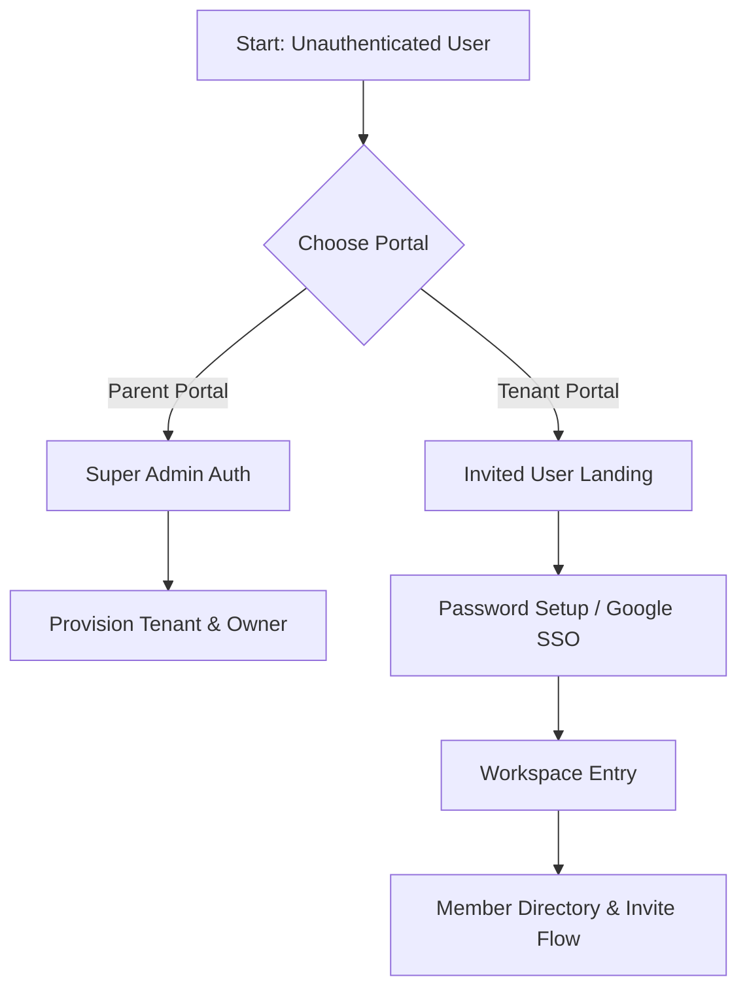

# Epic 11: Identity and Access Management — Manual Test Plan

This document outlines a comprehensive, step-by-step manual test suite to validate all security, infrastructure, administrative, and user-experience features implemented in **Epic 11: Identity and Access Management**.

---

## 1. Overview & Objectives
The primary goal of Epic 11 is to enforce zero-trust identity boundaries, enable multi-tenancy isolation, and establish administrative portals for system administration and organization management. 

This test plan ensures:
1. **Cryptographic Tenant Isolation**: Access is strictly gated by tenant-scoped identity tokens and IAP assertions.
2. **Robust Administrative Flows**: Organization onboarding, member invitation, and role-mapping operate seamlessly.
3. **Fail-Safe Platform Security**: The backend refuses to boot or process data under insecure configurations.
4. **Premium User Experience**: End-to-end invitation acceptance, authentication, and organization switching are fluid and responsive.

---

## 2. Test Environment Setup & Prerequisites

Before executing the test cases, ensure your local environment is configured to run the backend and frontend in the correct modes.

### A. Core Requirements
* **Go SDK**: version `1.26.1` or higher.
* **Node.js & npm**: to run the frontend developer server.
* **Firebase Emulator Suite**: specifically running the **Auth Emulator** (port `8085`) and **Firestore Emulator** (port `8084`).
* **Mise Tooling**: installed and active in the workspace.

### B. Environment Configurations
1. **Local Development Mode (Bypass Mode)**:
   * File: `api/.env` (or set via terminal environment variables)
   * Values:
     ```env
     ENVIRONMENT=local
     BYPASS_IAP_VALIDATION=true
     FIRESTORE_EMULATOR_HOST=localhost:8084
     FIREBASE_AUTH_EMULATOR_HOST=localhost:8085
     JWT_SECRET=dev-secret-key-that-must-be-changed-in-production-12345
     ```
2. **Production/Strict Simulation Mode**:
   * Values:
     ```env
     ENVIRONMENT=production
     BYPASS_IAP_VALIDATION=false
     IAP_AUDIENCE=/projects/123456789/global/backendServices/mock-backend-service
     JWT_SECRET=production-strength-secret-key-must-be-at-least-32-chars-long
     ```

### C. Seed State
* Ensure the local databases are seeded by running:
  ```bash
  go run ./api/seeding/main.go -env local
  ```
  This provisions two default tenants in the Auth Emulator and Firestore:
  * **The High Council** (`apf-local-tenant-hc`)
  * **The Sith Order** (`apf-local-tenant-so`)

---

## 3. Test Cases



---

### Case 11.1: Google Identity Platform IaC & Tenant Capability
**Objective:** Verify that the underlying authentication infrastructure is provisioned correctly with multi-tenancy and secure password rules.

*   **Story Reference:** 11.1
*   **Target Components:** Terraform Infrastructure, Google Identity Platform Configuration
*   **Prerequisites:** Terraform access to target GCP project.

#### Steps:
1. Run Terraform plan/apply in the infrastructure directory (`infra/`):
   ```bash
   cd infra
   terraform plan -out=tfplan
   ```
2. Inspect the generated `tfplan` or the active GCP console configuration and verify:
   * **Multi-Tenancy**: `allow_tenants` is set to `true`.
   * **Email/Password Provider**: Configured as enabled with `password_required = true`.
   * **Duplicate Emails**: Disallowed globally across the project.
   * **Google OAuth IDP**: Enabled if client credentials are provided.

#### Expected Result:
* [x] The Terraform plan shows successful initialization of Google Identity Platform.
* [x] Multi-tenancy is active, allowing programmatic tenant creation.
* [ ] Attempting to sign up two separate users with the exact same email under the same tenant fails with an email-already-in-use error.

---

### Case 11.2: Identity-Aware Proxy (IAP) Middleware Gating
**Objective:** Verify that requests without valid IAP headers are blocked in production mode, and that valid headers successfully propagate user identity.

*   **Story Reference:** 11.2, 11.9
*   **Target Components:** `api/middleware.go` (`resolveClaims`)
*   **Prerequisites:** Backend running in production mode (`BYPASS_IAP_VALIDATION=false`).

#### Steps:
1. Start the API server in production mode:
   ```bash
   ENVIRONMENT=production BYPASS_IAP_VALIDATION=false IAP_AUDIENCE=test-audience JWT_SECRET=super-secure-jwt-secret-at-least-32-chars-long go run ./api
   ```
2. Send a `GET` request to a protected endpoint (e.g., `/api/v1/projects`) using `curl` without any headers:
   ```bash
   curl -i http://localhost:8081/api/v1/projects
   ```
3. Send the request again, adding a malformed `X-Goog-IAP-JWT-Assertion` header:
   ```bash
   curl -i -H "X-Goog-IAP-JWT-Assertion: malformed.token.here" http://localhost:8081/api/v1/projects
   ```
4. Send the request with a valid, signed mock IAP assertion (signed with the private key matching the `IAP_AUDIENCE` signature keys):
   ```bash
   curl -i -H "X-Goog-IAP-JWT-Assertion: <valid_iap_token>" http://localhost:8081/api/v1/projects
   ```

#### Expected Result:
* [ ] Step 2: The server immediately rejects the request with **`401 Unauthorized`**.
* [ ] Step 3: The server immediately rejects the request with **`401 Unauthorized`** and logs a warning about token verification failure.
* [ ] Step 4: The server successfully validates the token, extracts the claims (email, subject, tenant ID), injects them into the Go context, and routes the request (returning a `200 OK` or `403 Forbidden` if the user lacks organization membership, but not a `401`).

---

### Case 11.3: Super Admin Portal — Organization & Tenant Provisioning
**Objective:** Verify that a Super Administrator can bootstrap a brand-new organization tenant and register its owner.

*   **Story Reference:** 11.3
*   **Target Components:** `api/admin_handlers.go` (`createOrganizationHandler`), `ui/src/app/admin/provision/page.tsx`
*   **Prerequisites:** Logged in as a Super Admin (no tenant-scope) on the Super Admin Portal.

#### Steps:
1. Navigate to the Super Admin Portal in the UI (e.g., `/admin/provision`).
2. Locate the **Provision Organization** form.
3. Input the following details:
   * **Organization Name**: `Galactic Senate`
   * **Owner's Email**: `chancellor@senate.galaxy`
4. Click the **Provision Organization** button.
5. In another terminal, check the Firebase Auth Emulator UI (`localhost:4000/auth` or equivalent) and Firestore Emulator UI (`localhost:4000/firestore`).

#### Expected Result:
* [x] The UI displays a progress indicator, followed by a success message displaying the newly generated tenant ID (e.g., `galactic-senate-XXXX`).
* [x] In the Firebase Auth Emulator, a new **Tenant** named `Galactic Senate` is created.
* [x] Under this tenant, a user with the email `chancellor@senate.galaxy` is created.
* [x] The user's Custom Claims are set to `{ "role": "owner" }`.
* [x] In Firestore, a new document exists at `/organizations/{generated_tenant_id}` with the name `Galactic Senate`.

---

### Case 11.4: Member Directory & Role Modification
**Objective:** Verify that an organization owner/admin can view their organization members, modify user roles, and revoke tenant access.

*   **Story Reference:** 11.4
*   **Target Components:** `api/user_handlers.go`, `ui/src/app/(dashboard)/settings/page.tsx`
*   **Prerequisites:** Authenticated as Owner (`chancellor@senate.galaxy`) in the `Galactic Senate` organization.

#### Steps:
1. Log in to the application and select the **Galactic Senate** organization.
2. Navigate to the **Settings** screen and scroll to the **Member Directory** section.
3. Verify that the table lists `chancellor@senate.galaxy` with the role `owner`.
4. Click the action menu next to another user (e.g., `senator@senate.galaxy`) and select **Change Role**.
5. Choose the role **Admin** and click **Save**.
6. Verify the updated role in the UI table.
7. Click the action menu next to that user again and select **Revoke Access** (Delete).
8. Confirm the deletion.

#### Expected Result:
* [ ] The UI renders a complete table of users fetched via `tenantAuth.listUsers()`.
* [ ] Step 5: The backend successfully updates the user's custom claims to `{ "role": "admin" }` in Firebase Auth.
* [ ] Step 6: The UI immediately reflects the new role.
* [ ] Step 7-8: The user is permanently deleted from the Firebase Auth Tenant and their Firestore user document is removed. They can no longer log in.

---

### Case 11.5: Member Invitation Flow & Email Link Generation
**Objective:** Verify that an administrator can invite a new member to their organization, generating a secure tenant-scoped sign-in link.

*   **Story Reference:** 11.5
*   **Target Components:** `api/admin_handlers.go` (`GenerateInvitationLink`), `ui/src/components/shared/InviteMemberModal.tsx`
*   **Prerequisites:** Authenticated as Owner/Admin in the `Galactic Senate` organization.

#### Steps:
1. On the **Settings > Member Directory** section, click the **Invite Member** button.
2. In the modal, enter:
   * **Email**: `padme@naboo.galaxy`
   * **Role**: `Editor`
3. Click **Send Invite**.
4. Check the backend console logs or the simulated email inbox (in local emulator mode, check the terminal output of the Auth Emulator).

#### Expected Result:
* [ ] The modal displays a success message: "Invitation sent successfully".
* [ ] The backend generates a secure, tenant-scoped link containing the tenant ID and email:
  `http://localhost:8082/accept-invite?email=padme%40naboo.galaxy&tenantId=galactic-senate-XXXX`
* [ ] In Firestore, a pending invitation document is created under `/organizations/galactic-senate-XXXX/users/padme@naboo.galaxy` containing:
  ```json
  {
    "email": "padme@naboo.galaxy",
    "role": "editor"
  }
  ```

---

### Case 11.6: Custom Roles & Permissions Configuration
**Objective:** Verify that custom roles can be created with granular permissions, and that assigning a custom role correctly propagates permissions to the user's custom claims.

*   **Story Reference:** 11.6
*   **Target Components:** `api/role_handlers.go`, `ui/src/pages/RolesConfiguration`
*   **Prerequisites:** Authenticated as Owner/Admin in the `Galactic Senate` organization.

#### Steps:
1. Navigate to the **Settings > Roles & Permissions** screen.
2. Select the **Predefined Roles** tab. Verify that `Admin`, `Editor`, and `Viewer` are listed as read-only with their default permissions.
3. Switch to the **Custom Roles** tab and click **Create Custom Role**.
4. Enter:
   * **Role Name**: `Jedi Envoy`
   * **Permissions**: Check `read:data` and `invite:users`.
5. Click **Save Custom Role**.
6. Go back to the **Member Directory** screen.
7. Edit a user's role, and select the newly created **Jedi Envoy** custom role.
8. Check the user's custom claims in the Firebase Auth Emulator.

#### Expected Result:
* [ ] Step 2: Predefined roles are read-only and cannot be modified.
* [ ] Step 5: The custom role is saved in Firestore under `/organizations/{orgID}/roles/jedi-envoy`.
* [ ] Step 8: The user's custom claims are successfully updated to:
  ```json
  {
    "role": "Jedi Envoy",
    "permissions": ["read:data", "invite:users"]
  }
  ```

---

### Case 11.7: Invited User Experience (Accepting Invitation)
**Objective:** Verify that an invited user can click their link, set up their credentials, and log into the correct isolated tenant.

*   **Story Reference:** 11.7
*   **Target Components:** `ui/src/pages/AcceptInvitation`, Firebase Auth Client SDK
*   **Prerequisites:** Secure invitation link generated in Case 11.5 (`padme@naboo.galaxy`).

#### Steps:
1. Open a new private browser window (or clear local storage) and navigate to the invitation link:
   `http://localhost:8082/accept-invite?email=padme%40naboo.galaxy&tenantId=galactic-senate-XXXX`
2. Verify that the page branding and Title match the `Galactic Senate` organization name.
3. Input a new password in the password setup field and click **Complete Registration** (or click **Sign in with Google**).
4. Upon successful registration, verify the redirection and check the active session token.

#### Expected Result:
* [ ] The page successfully initializes the Client SDK scoped to the tenant ID: `auth.tenantId = "galactic-senate-XXXX"`.
* [ ] The password setup form successfully creates the user inside the `galactic-senate-XXXX` tenant.
* [ ] The user is automatically logged in and redirected to the **Galactic Senate** dashboard.
* [ ] The session token stored in `localStorage` contains the correct custom claims: `{ role: "editor", permissions: ["read:data", "write:data"] }`.
* [ ] In Firestore, the invitation document at `/organizations/galactic-senate-XXXX/users/padme@naboo.galaxy` is deleted, and a new user profile document at `/organizations/galactic-senate-XXXX/users/{uid}` is created.

---

### Case 11.8: Parent Project Super Admin Global Resource Access
**Objective:** Verify that a Super Admin can log in at the root project level and perform global operations, while tenant users are restricted.

*   **Story Reference:** 11.8
*   **Target Components:** `api/middleware.go` (Super Admin validation)
*   **Prerequisites:** A root project user with claim `{ "is_super_admin": true }` created.

#### Steps:
1. Log in to the **Super Admin Portal** as the Super Admin (`super-admin@agentic-foundry.local`).
2. Verify that the Auth SDK initializes *without* setting `auth.tenantId` (authenticating against the root parent project).
3. Perform an administrative action, such as listing all organizations.
4. Now, log in as a standard tenant user (e.g., `user1@agentic-foundry.local` in `The High Council`).
5. Attempt to access the Super Admin API endpoint directly:
   ```bash
   curl -i -H "Authorization: Bearer <tenant_user_token>" http://localhost:8081/api/v1/admin/organizations
   ```

#### Expected Result:
* [ ] Step 2: The Super Admin token is minted at the root project level (no `firebase.tenant` claim) and contains `{ "is_super_admin": true }`.
* [ ] Step 3: The backend verifies the token, recognizes the global super admin claim, and authorizes the action (`200 OK`).
* [ ] Step 5: The backend rejects the tenant user's request with **`403 Forbidden`** because their token is scoped to a tenant and lacks the global `is_super_admin` claim.

---

### Case 11.9: Startup Self-Test & Insecure Configuration Panic
**Objective:** Verify that the backend refuses to start up in production if critical security parameters are missing, malformed, or misconfigured.

*   **Story Reference:** 11.9
*   **Target Components:** `api/core/configuration.go` (`NewConfig`)
*   **Prerequisites:** Terminal access to run the backend.

#### Steps:
1. Attempt to start the backend in **production** mode without providing `IAP_AUDIENCE`:
   ```bash
   ENVIRONMENT=production JWT_SECRET=super-secure-secret-key-at-least-32-chars go run ./api
   ```
2. Attempt to start the backend in **production** mode with `BYPASS_IAP_VALIDATION=true`:
   ```bash
   ENVIRONMENT=production IAP_AUDIENCE=test-aud JWT_SECRET=super-secure-secret-key-at-least-32-chars BYPASS_IAP_VALIDATION=true go run ./api
   ```
3. Attempt to start the backend in **production** mode with a short `JWT_SECRET` (less than 32 characters):
   ```bash
   ENVIRONMENT=production IAP_AUDIENCE=test-aud JWT_SECRET=short-key BYPASS_IAP_VALIDATION=false go run ./api
   ```

#### Expected Result:
* [ ] Step 1: The application immediately panics and exits on startup:
  `panic: Configuration error: IAP_AUDIENCE must be set in production mode`
* [ ] Step 2: The application immediately panics and exits on startup:
  `panic: Configuration error: BYPASS_IAP_VALIDATION cannot be true in production mode`
* [ ] Step 3: The application immediately panics and exits on startup:
  `panic: Configuration error: JWT_SECRET must be at least 32 characters long in production mode`

---

## 4. Verification Checklists & Sign-Off

To officially sign off on Epic 11, the following checkboxes must be marked as complete during manual testing:

### Infrastructure & Gating
- [ ] Terraform configs successfully enable multi-tenancy and secure password requirements.
- [ ] No request can reach protected APIs in production without a valid IAP assertion.
- [ ] Cleartext headers (`x-goog-authenticated-user-email` / `X-Organization-Id`) are strictly ignored in production.

### Portals & User Directory
- [ ] Super Admins can successfully provision new tenants and assign initial owners.
- [ ] Organization owners/admins can view members, edit roles, and delete members.
- [ ] Invited users can accept their invitation via email link, set up passwords, and gain scoped organization access.
- [ ] Custom roles can be created, edited, and successfully map granular permissions to users.

### Fail-Safe Guards
- [ ] The API server crashes immediately on startup if `IAP_AUDIENCE` or `JWT_SECRET` are missing or weak in production.
- [ ] Cross-tenant access attempts (using a token from Tenant A to access Tenant B) return a `403 Forbidden` error.
