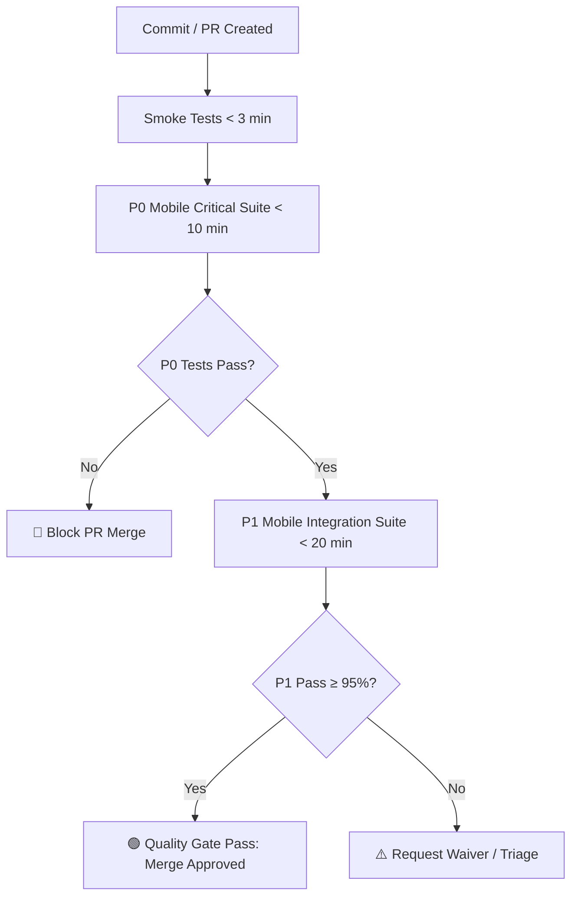

# Test Design & Strategy: Epic 13 — Mobile Application Development Experience

**Date:** 2026-07-22  
**Author:** Murat (Master Test Architect)  
**Status:** Approved  
**Target Scope:** Epic 13 (Mobile Application Development Experience — Stories 13.1 through 13.7)  

---

## Executive Summary

**Scope:** Epic-level test design and risk assessment for **Epic 13: Mobile Application Development Experience**. Epic 13 brings the full Agentic Foundry platform—including agent chat, visual node workflows, workspace exploration, user settings, product tours, and real-time push notifications—to mobile and small-breakpoint (< 768px) viewports (iOS, Android, and mobile web).

**Risk Summary:**
- **Total Risks Identified:** 6
- **High-Priority Risks (Score ≥ 6):** 4 (Security, Touch Performance, Real-Time Push Sync, Viewport Obstructive UX)
- **Critical Categories:** SEC, PERF, TECH, BUS, DATA, OPS

**Coverage Summary:**
- **P0 Scenarios:** 12 tests (~24 hours)
- **P1 Scenarios:** 14 tests (~14 hours)
- **P2/P3 Scenarios:** 10 tests (~6 hours)
- **Total Effort Estimate:** 36 tests across 44 hours (~5.5 engineering days)

---

## Scope & Story Breakdown

| Story ID | Story Title | Primary Scope & Target Artifacts |
|---|---|---|
| **13.1** | Mobile Projects Dashboard Screen | Single-column touch grid (<768px), touch targets $\ge 48\times48$px, status badges (`New`, `Onboarding`, `Onboarded`), showcase project initialization. |
| **13.2** | Mobile Agent Chat Workspace Screen | Fluid mobile message stream, quick prompt chips above virtual keyboard, collapsible context drawers, response cancellation triggers. |
| **13.3** | Mobile Touch Canvas & Node Workflow Screen | Multi-touch gestures (pinch-to-zoom, drag-pan with $<100$ms latency), bottom sheet node inspector, double-tap/long-press node actions. |
| **13.4** | Mobile Workspace Explorer & Spec Viewer Screen | Touch directory tree picker, mobile Markdown reader with copy & section navigation, bounded screen diff viewer. |
| **13.5** | Mobile User Settings & API Secrets Screen | Secure API secret input fields with visibility toggles, encrypted persistence, touch radio cards for persona defaults. |
| **13.6** | Mobile Product Onboarding Tour Screen & Overlays | Dynamic non-obstructive popovers, swipe & touch controls, step progress indicators, Firestore tour state sync. |
| **13.7** | Mobile Push Notifications & Task Sync Engine | Web Push / FCM integration, background task completion triggers, deep-linking directly to chat/approval screens on push tap. |

---

## Risk Assessment Matrix

### High-Priority Risks (Score ≥ 6)

| Risk ID | Category | Description | Probability (1–3) | Impact (1–3) | Score | Mitigation | Owner | Timeline |
|---|---|---|---|---|---|---|---|---|
| **R-001** | **SEC** | Unmasked or unencrypted API secrets (Figma/GitHub tokens) in mobile local storage or transient UI states on mobile viewports. | 2 | 3 | **6** | Mask inputs, enforce encrypted Firestore/secret-manager persistence, omit secrets from client logs & local storage. | Dev Lead | Sprint 13.1 |
| **R-002** | **PERF** | Touch Canvas gesture lag ($>100$ms response latency or frame drops) during multi-touch pinch-to-zoom / drag-pan on complex node graphs. | 3 | 2 | **6** | Implement canvas render throttling, hardware-accelerated CSS transforms, and low-latency gesture listeners. | UX / Front | Sprint 13.2 |
| **R-003** | **TECH** | Mobile Web Push / FCM notification payload failure or broken deep-linking when app is in background/terminated state. | 2 | 3 | **6** | Implement fallback sync worker, validate FCM token renewal lifecycle, and write E2E deep-link integration tests. | QA / Backend | Sprint 13.3 |
| **R-004** | **BUS** | Virtual soft keyboard obstructing mobile chat input field or quick action prompt chips during message composition. | 3 | 2 | **6** | Implement dynamic viewport height (`dvh`) CSS listeners, automatic scroll-into-view triggers, and input focus handlers. | QA / Front | Sprint 13.1 |

### Medium & Low-Priority Risks (Score 1–4)

| Risk ID | Category | Description | Probability (1–3) | Impact (1–3) | Score | Action / Mitigation | Owner |
|---|---|---|---|---|---|---|---|
| **R-005** | **DATA** | Onboarding tour state desynchronization between Firestore and local mobile client causing repeated tour popups. | 2 | 2 | **4** | Enforce optimistic state update with Firestore listener confirmation. | Front Lead |
| **R-006** | **OPS** | Touch target size violations ($<48\times48$px) causing mis-taps on small screen breakpoints ($<375$px). | 2 | 1 | **2** | Automated axe-core / Playwright accessibility audit enforcing minimum touch target bounding boxes. | QA Lead |

---

## NFR Planning & Evidence Strategy

| NFR Category | Requirement / Threshold | Risk Link | Planned Validation | Target Evidence Artifact |
|---|---|---|---|---|
| **Security** | Masked inputs, zero plain-text token logging, encrypted persistence for mobile user secrets. | R-001 | API test suite validating response payload sanitization; mobile UI secret visibility toggle audit. | Automated API test report (`test-results/sec-secrets.json`) |
| **Performance** | Touch Canvas gesture reaction $<100$ms; frame rate $\ge 55$ FPS during pan/zoom. | R-002 | Playwright CDP trace performance profiling; Lighthouse Mobile audit score $\ge 90$. | Playwright Trace Viewer log & Lighthouse report |
| **Reliability** | FCM / Web Push delivery success rate $\ge 99\%$; deep-link resolution $\le 500$ms on push tap. | R-003 | Automated notification daemon integration test; FCM token refresh simulation. | FCM Test Execution Log |
| **Usability / Accessibility** | All interactive touch elements $\ge 48\times48$px; responsive layouts down to 320px width. | R-004, R-006 | Automated viewport audit across 320px, 375px, and 768px breakpoints. | Playwright Viewport Bounding Box Audit |

---

## Entry & Exit Criteria

### Entry Criteria
- [x] Epic 13 user stories (13.1 to 13.7) and acceptance criteria finalized in `epics.md`.
- [ ] Mobile responsive layout breakpoints (<768px) and touch component library configured.
- [ ] FCM / Web Push sandbox environment provisioned for mobile notification testing.
- [ ] Playwright Mobile Emulation devices (iPhone 14, Pixel 7) configured in test framework.

### Exit Criteria
- [ ] 100% of P0 mobile tests passing cleanly without flakiness across iOS & Android emulators.
- [ ] All high-priority risks (R-001 through R-004) verified mitigated.
- [ ] Touch target bounding box audit confirms 0 elements $< 48\times48$px on primary actions.
- [ ] Zero unhandled soft keyboard viewport occlusion defects reported.

---

## Test Coverage Plan

### P0 (Critical) — Run on Every Pull Request / Commit

**Criteria:** Core mobile user journeys, security secret protection, and touch canvas usability.

| Story | Test Scenario | Test Level | Risk Link | Test Count | Owner | Target Verification |
|---|---|---|---|---|---|---|
| **13.1** | Touch target size audit on single-column project grid tiles ($\ge 48\times48$px). | UI / E2E | R-006 | 2 | QA | Bounding box inspection on 375px viewport. |
| **13.2** | Mobile Chat virtual keyboard focus — prompt chips remain visible above keyboard. | E2E | R-004 | 2 | QA | Visual viewport height (`dvh`) adjustment assertion. |
| **13.3** | Multi-touch gesture canvas pan/zoom latency test ($<100$ms response). | E2E / Perf | R-002 | 2 | QA | Playwright CDP event duration measurement. |
| **13.3** | Canvas node tap opens mobile bottom sheet with correct spec metadata. | E2E | R-002 | 2 | QA | Bottom sheet DOM visibility & spec content check. |
| **13.5** | API key input masking, visibility toggle, and encrypted payload submission. | API / E2E | R-001 | 2 | Dev / QA | Password type validation & API request payload check. |
| **13.7** | FCM Push Notification tap deep-links directly to target agent chat screen. | E2E | R-003 | 2 | QA | Deep-link URI handler & workspace state validation. |

**Total P0:** 12 tests | ~24 hours development effort

---

### P1 (High) — Run on PR to Main / Integration Build

**Criteria:** Key feature functionality, mobile navigation, and product onboarding.

| Story | Test Scenario | Test Level | Risk Link | Test Count | Owner | Target Verification |
|---|---|---|---|---|---|---|
| **13.1** | Project status badges (`New`, `Onboarding`, `Onboarded`) render correctly on mobile tiles. | Component | - | 3 | Dev | Mobile component snapshot test. |
| **13.2** | Agent persona switching (`bmad-pm`, `bmad-ux`, `bmad-dev`) updates mobile header & theme. | E2E | - | 3 | QA | Persona state transition validation. |
| **13.4** | Mobile Workspace Explorer file tree expand/collapse touch navigation. | E2E | - | 2 | QA | Touch tree tap & file list rendering. |
| **13.4** | Mobile Markdown viewer renders file diffs bounded within screen width without horizontal scroll. | UI | - | 2 | QA | Viewport overflow-x CSS audit. |
| **13.6** | Product Onboarding Tour popover positioning avoids obscuring bottom nav bar. | UI / E2E | R-005 | 2 | QA | Element collision & z-index inspection. |
| **13.6** | Swiping "Next" advances product tour step and syncs progress to Firestore. | API / E2E | R-005 | 2 | QA | Firestore user document state verification. |

**Total P1:** 14 tests | ~14 hours development effort

---

### P2 & P3 (Medium / Low) — Run Nightly & On-Demand

**Criteria:** Edge cases, secondary interactions, showcase init, and cosmetic polish.

| Story | Test Scenario | Test Level | Risk Link | Test Count | Owner | Target Verification |
|---|---|---|---|---|---|---|
| **13.1** | Tapping Showcase project card initializes demo workspace on mobile screen. | Integration | - | 2 | Dev | Demo workspace payload & route change. |
| **13.2** | Response cancellation button halts active streaming LLM response on mobile. | E2E | - | 2 | QA | Stream abort controller assertion. |
| **13.4** | Copy button in Mobile Spec Viewer copies code snippet to mobile clipboard. | E2E | - | 2 | QA | Navigator.clipboard inspection. |
| **13.5** | Persona radio card selection persists user defaults across sessions. | Integration | - | 2 | Dev | Local storage & user profile API check. |
| **13.6** | "Skip Tour" button dismisses onboarding overlay permanently across reloads. | E2E | - | 2 | QA | Reload app and verify tour does not launch. |

**Total P2/P3:** 10 tests | ~6 hours development effort

---

## Execution Order & CI Pipeline Integration

1. **PR Level (<10 min):** P0 Critical Suite (Mobile Auth, Secret Masking, Keyboard Viewport, Touch Bounding Boxes).
2. **Nightly Build (<30 min):** P1 + P2 Full Mobile Suite across Mobile Web (Chrome Emulation), iOS Safari Simulator, and Android Emulator.
3. **Weekly Release Gate:** Full NFR Audit (Touch Canvas FPS profiling, FCM push notification verification).

---

## Resource & Effort Estimation

| Priority Tier | Test Count | Dev Hours / Test | Total Dev Hours | Estimated Timeline |
|---|---|---|---|---|
| **P0 (Critical)** | 12 | 2.0 | 24 hours | ~3.0 Days |
| **P1 (High)** | 14 | 1.0 | 14 hours | ~1.75 Days |
| **P2 / P3 (Medium/Low)** | 10 | 0.6 | 6 hours | ~0.75 Days |
| **TOTAL** | **36 Tests** | **-** | **44 Hours** | **~5.5 Engineering Days** |

---

## Quality Gate Thresholds

- **P0 Pass Rate:** **100%** (zero failures allowed for mobile secrets, target sizes, and critical layout).
- **P1 Pass Rate:** **$\ge 95\%$** (failures must be triaged with documented PM/QA waivers).
- **Touch Target Compliance:** 100% of interactive components on $<768$px screens must measure $\ge 48\times48$px.
- **Gesture Performance:** Touch Canvas drag-pan & pinch-to-zoom reaction time $< 100$ms.
- **Security Compliance:** 0 plain-text secrets in mobile logs or HTTP request params.

---

## Interworking & Regression Scope

| Component / Service | Impacted Feature | Regression Scope & Required Verification |
|---|---|---|
| **Agentic Foundry API Gateway** | Secret Persistence (`13.5`) | Verify Go reverse proxy sanitizes headers and retains IAP tenant context on mobile requests. |
| **Firestore Sync Engine** | Product Tour State (`13.6`) | Verify user onboarding progress document structure is backward-compatible with desktop UI. |
| **Antigravity Chat Engine** | Mobile Chat Stream (`13.2`) | Verify SSE response streaming functions cleanly over mobile cellular / throttled networks. |

---

**Generated by:** Murat — Master Test Architect  
**Workflow:** `bmad-testarch-test-design`  
**Output Path:** `docs/spec/testing-artifacts/epic-13-test-plan.md`  
