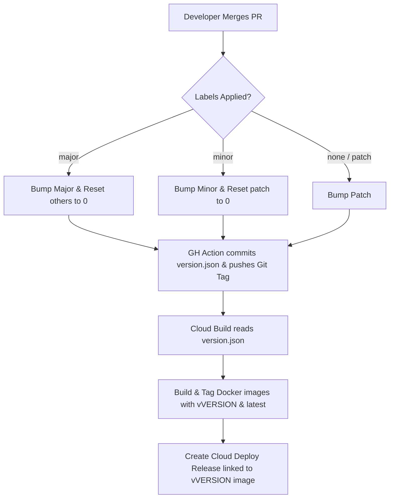

# Label-Based Versioning & Release Strategy

This document outlines the automated **Mainline** versioning and release strategy implemented for the repository. 

The strategy connects three components:
1. **GitHub Actions** to manage label-based version calculations, commits, and Git tagging.
2. **Google Cloud Build** to compile code and tag Docker images in Artifact Registry using the computed release version.
3. **Google Cloud Deploy** to launch service releases associated with specific versioned images.

---

## Architectural Overview



---

## Prerequisites

1. **Initial Version File**: A `version.json` file must exist at your repository root containing the current semantic version:
   ```json
   {
     "version": "1.0.0"
   }
   ```
2. **GitHub Action Permissions**: The workflow requires repository write access to push back version commits and release tags. Ensure **Read and write permissions** are enabled under **Settings > Actions > General > Workflow permissions**.

---

## How It Works

### 1. Pull Request & Labeling
When creating a pull request (PR) to the `main` branch, developers assign one of the following labels:
* `major` &mdash; Breaking changes.
* `minor` &mdash; Backward-compatible new features.
* `patch` &mdash; Backward-compatible bug fixes.

### 2. Version Calculation & Tagging (GitHub Action)
Upon merging the PR, `.github/workflows/version-bump.yml` executes:
* It parses the current version from `version.json`.
* Based on the applied PR label, it increments the version.
* It writes the new version to `version.json`, commits the change, tags the commit (`vX.Y.Z`), and pushes the updates back to `main`.

### 3. Image & Release Compilation (Cloud Build)
Google Cloud Build reads the updated version from `version.json` and performs the following:
* **Build**: Builds the Docker images for all services (`ui`, `api`, `ai`).
* **Tagging**: Tags each image with both `:latest` and the newly calculated release version (e.g., `:v1.0.1`).
* **Release**: Creates an immutable Cloud Deploy release containing the exact version-tagged images instead of referencing a mutable `:latest` tag.

---

## Developer Guide: How to Label Your Pull Request

To ensure the automated versioning system categorizes your release correctly, follow these guidelines when opening or updating a Pull Request:

### 1. Assess the Impact of Your Changes
Before labeling, categorize your PR based on its potential impact:
* **`major`** &mdash; **Breaking Changes**. Any change that breaks backward compatibility (e.g., deleting/renaming API endpoints, modifying database schemas in a backward-incompatible way, breaking UI contracts).
* **`minor`** &mdash; **New Features**. Any backward-compatible addition (e.g., new API endpoints, new UI views, optional configuration parameters).
* **`patch`** &mdash; **Bug Fixes & Chores**. Backward-compatible bug fixes, performance optimizations, or simple documentation updates.

### 2. Apply the Label on GitHub
1. Navigate to your Pull Request page on the GitHub repository.
2. In the right-hand sidebar, click the **Settings (gear)** icon next to **Labels**.
3. Search for and select `major`, `minor`, or `patch`.
4. Make sure at least one label is applied. (If multiple labels are applied, the system will prioritize the highest-level change).

---

## Example Scenarios & Edge Cases

### Scenario 1: No label or unrecognized labels are assigned
* **Behavior**: If a PR is merged with no labels, or only unrecognized labels (e.g., `documentation`, `chore`), the workflow automatically falls back to a **Patch** increment.
* **Example**: `1.0.0` &rarr; `1.0.1`
* **Rationale**: This ensures that every single merge into `main` is guaranteed to advance the version, avoiding duplicate release name collisions.

### Scenario 2: Multiple labels are applied (e.g., `major` and `minor` together)
* **Behavior**: The workflow processes conditionals sequentially and prioritizes the **largest increment** (Major > Minor > Patch).
* **Example**: A PR with both `major` and `minor` labels will trigger a **Major** version bump (`1.4.2` &rarr; `2.0.0`). A PR with both `minor` and `patch` will trigger a **Minor** version bump (`1.4.2` &rarr; `1.5.0`).

### Scenario 3: Manual version updates in a PR commit
* **Behavior**: Since the Action executes *after* the PR merge is completed on the `main` branch, any manual edits you make to `version.json` inside the PR commits are respected as the new baseline.
* **Example**: If you manually edit `version.json` to `2.5.0` in a commit, and then merge the PR with a `patch` label, the Action reads `2.5.0` and increments it to **`2.5.1`**.

### Scenario 4: Setting an exact version manually / Bypassing automation
* **Behavior**: To set an exact version manually without any subsequent automated increment, edit `version.json` and include **`[skip ci]`** anywhere in the commit message.
* **Outcome**: The GitHub Action bypasses execution entirely, preserving the exact version number written in your commit as the release baseline.

---

## How to Test on a Feature Branch

To verify the versioning workflow without merging changes to `main`:

1. **Temporarily adjust branch targets** in `.github/workflows/version-bump.yml` by changing `main` to your feature branch name (e.g., `feature/versioning-setup`):
   * **Trigger branch**:
     ```yaml
     on:
       pull_request:
         types: [closed]
         branches:
           - feature/versioning-setup
     ```
   * **Push target (Commit and Tag step)**:
     ```yaml
     - name: Commit and Tag
       run: |
         ...
         git push origin feature/versioning-setup --follow-tags
     ```

2. **Commit and push** these temporary changes to your remote feature branch.
3. **Create a dummy branch** off your feature branch, make a minor change, and open a PR *into your feature branch*.
4. **Apply a label** (`major`, `minor`, or `patch`) to the PR, and click **Merge**.
5. **Confirm** the Action runs, updates `version.json`, and pushes the Git tag to your feature branch.
6. **Revert** target branches back to `main` before submitting your final PR.

---

## System Configurations

For the complete and active configuration files, please reference:

* **GitHub Actions Workflow**: [version-bump.yml](../.github/workflows/version-bump.yml) &mdash; Manages PR closure checks, version calculations, commits, and repository tagging.
* **Cloud Build Configuration**: [cloudbuild.yaml](../infra/cicd/cloudbuild.yaml) &mdash; Handles compiling code, adding Artifact Registry tags, and orchestrating Cloud Deploy releases.

---

## Manual Tagging & Release Operations

While automated label-based versioning is the standard, there are times when you may need to manually manage Git tags, clean up old references, or re-trigger a Cloud Build run for a specific release.

### 1. Creating a Standalone Git Tag
To ensure your new tag has its own correct creation timestamp (rather than inheriting the timestamp of the underlying commit), you should create an **Annotated Tag** instead of a lightweight one:

```bash
# 1. Create an annotated tag with a release message
git tag -a v0.1.0 -m "Release v0.1.0"

# 2. Push the tag to the origin remote
git push origin v0.1.0
```

### 2. Deleting & Pruning Remote/Local Tags
If a tag was pushed incorrectly and needs to be removed or synced:

```bash
# Delete the tag locally
git tag -d v0.1.0

# Delete the tag on the remote repository
git push origin --delete v0.1.0

# Clean up/prune local tags that no longer exist on remote origin
git fetch --prune --prune-tags
```

### 3. Manually Triggering a Build for a Specific Tag
If a webhook does not fire (e.g., when recreating a tag on an identical commit hash) or if you need to re-run a specific build manually, you can trigger Google Cloud Build directly using the `gcloud` CLI. 

> [!IMPORTANT]
> Cloud Build 2nd Gen triggers are **regional** resources. You must specify the `--region` flag for the command to succeed.

```bash
gcloud builds triggers run <TRIGGER_NAME> \
  --tag=<TAG_NAME> \
  --region=<REGION> \
  --project=<GCP_PROJECT_ID>
```

#### Example:
```bash
gcloud builds triggers run apf-deploy-staging-tag \
  --tag=v0.1.0 \
  --region=us-central1 \
  --project=apf-stg-project
```
